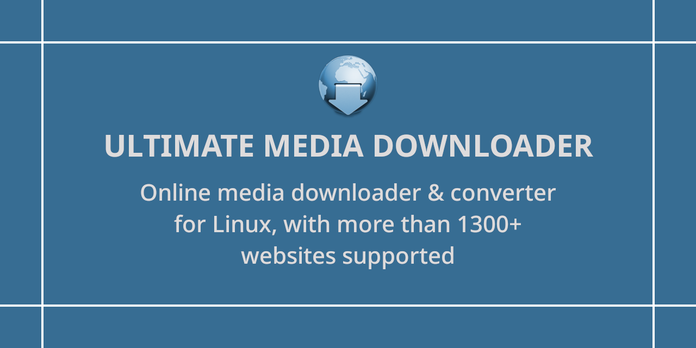
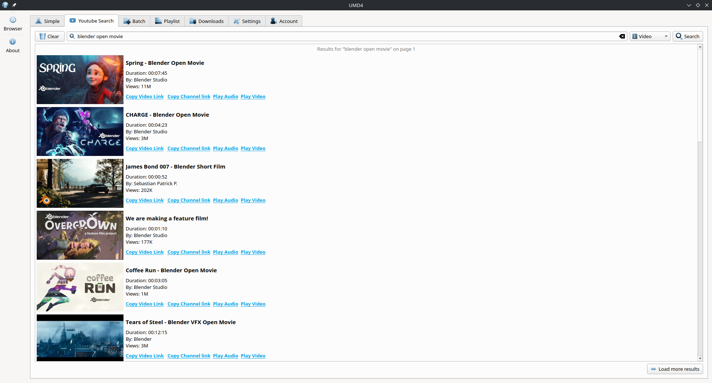
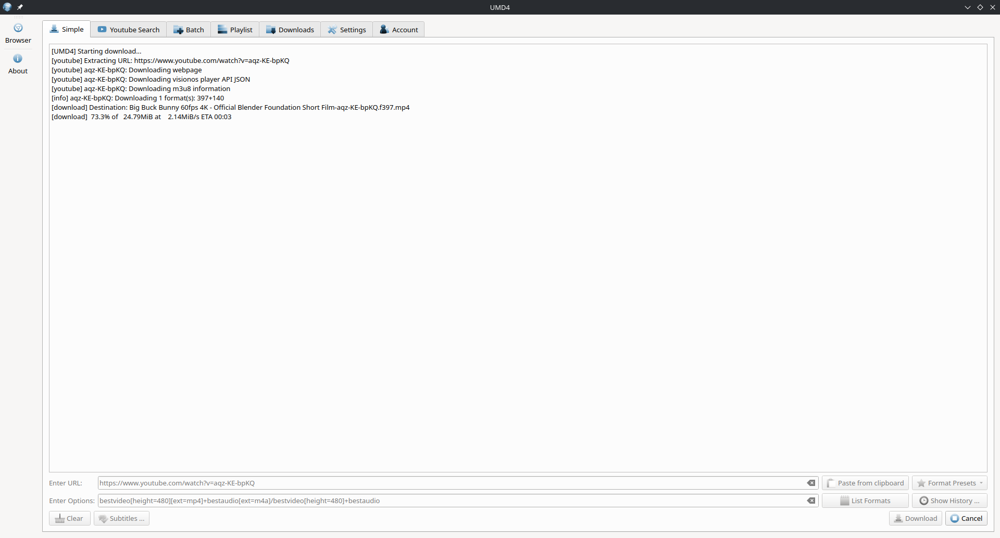
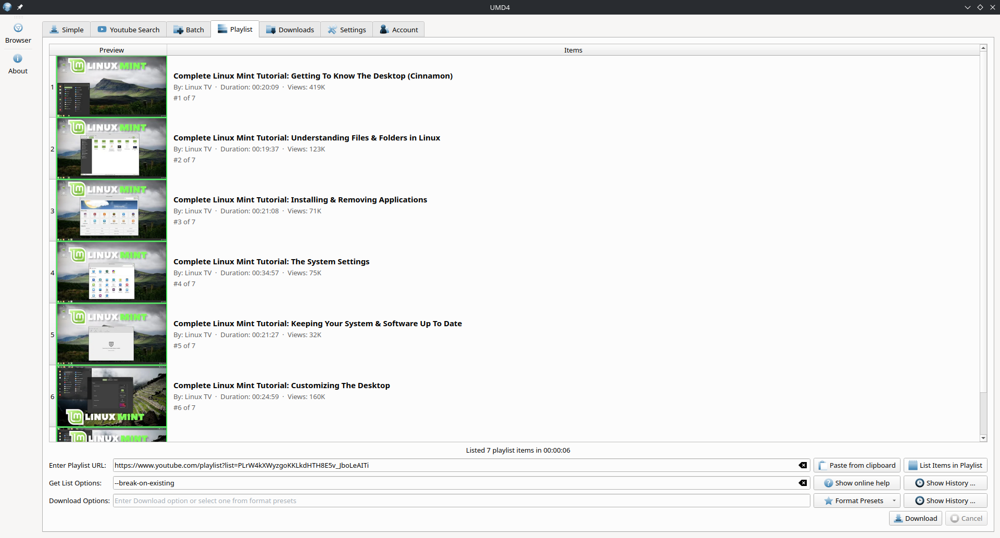
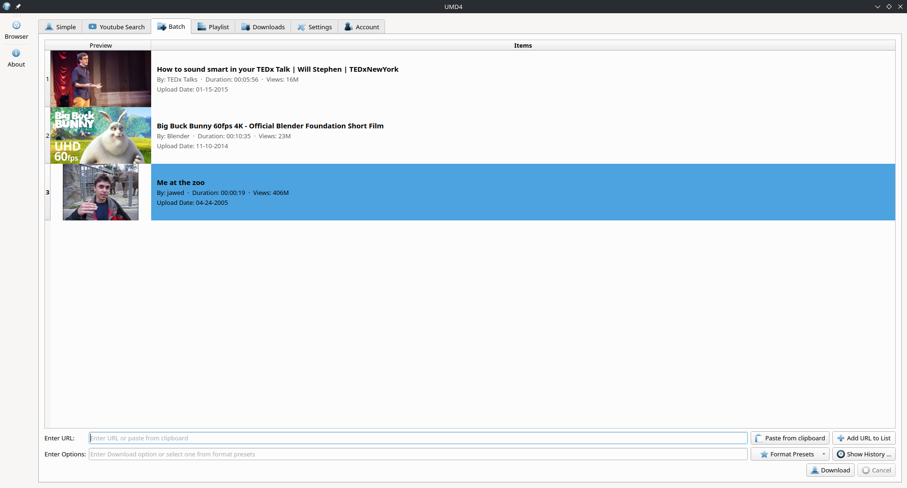
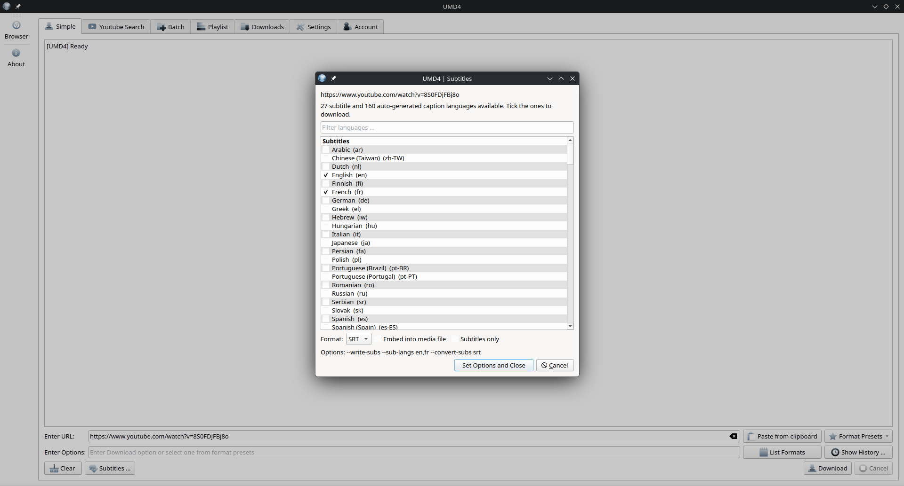
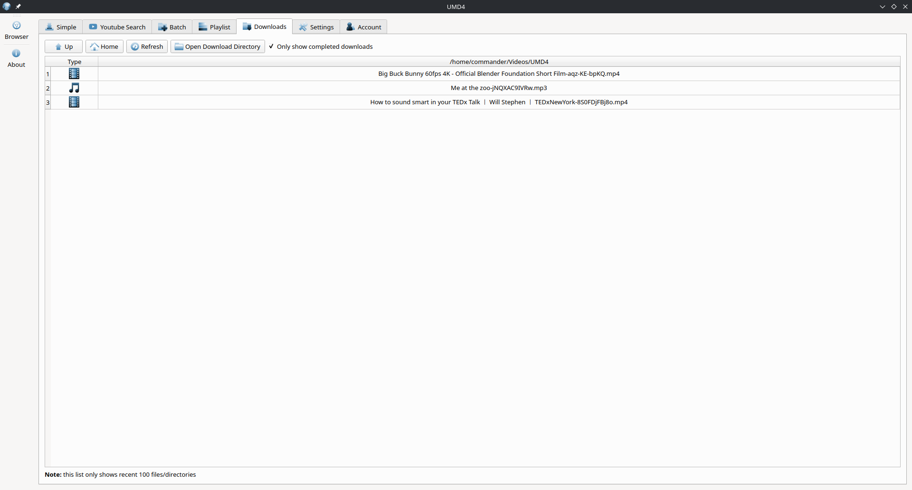
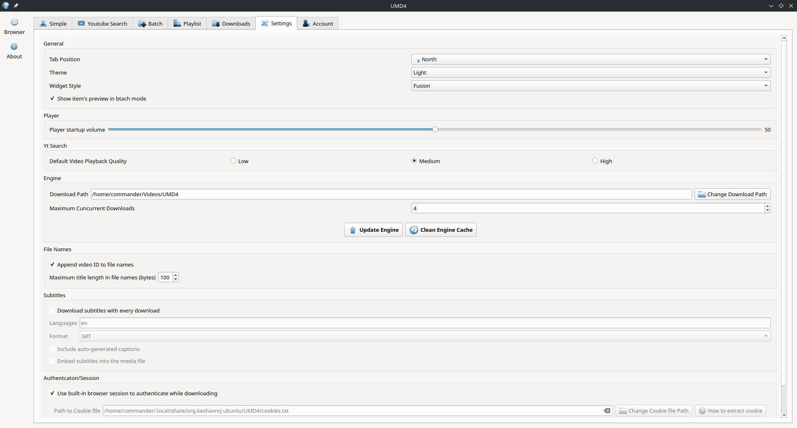

# Ultimate Media Downloader
Online video &amp; audio downloader for Linux, 1400+ websites support

  

Ultimate media downloader for Linux allows downloading Video/Audio from 100s of websites on the internet. It allows saving media from websites on Linux Desktop. Ultimate media downloader for Linux works with many sites including Youtube, Facebook, Instagram, Twitter, TikTok, Snapchat, etc

## Key features of Ultimate Media downloader:

* Comes with easy to use Basic Downloader
* 1300+ supported websites
* Direct Youtube Video and Audio only Playback with internal player without Ads
* Youtube Video and Playlist search to download media in bulk
* Batch media Downloader to download media in bulk
* Playlist Downloader allows downloading whole playlists
* Download Library Manager manage and interact with downloaded media
* Dark Theme supports out of the box
* Widget style switcher Adwaita, Adwaita Dark, and Fusion widget styles

## Install Ultimate Media downloader on Linux Desktop:

**Snap**

Install with command-line

`snap install ultimate-media-downloader`

and run

`ultimate-media-downloader`

**Flatpak**

Install with command-line

`flatpak install flathub com.ktechpit.ultimate-media-downloader`

and run

`flatpak run com.ktechpit.ultimate-media-downloader`

## Screenshots of Ultimate Media Downloader

  YouTube search with ad-free playback

  Download any link in the quality you want

  Whole playlists listed in seconds

  Batch downloads

  Subtitles in the languages a video offers

  Library of downloaded media

  Settings

